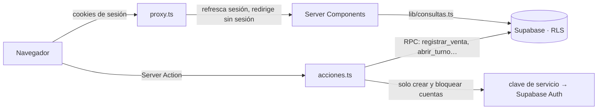

# Arquitectura

## Piezas

| Pieza | Papel |
|---|---|
| **Next.js 16 (App Router)** | Pantallas, Server Components, Server Actions y `proxy.ts` |
| **Supabase Auth** | Correo y contraseña, sesiones en cookies |
| **Supabase PostgreSQL** | Datos, reglas de negocio y seguridad (RLS y funciones) |
| **Tailwind 4** | Estilos con los tokens de `app/globals.css` |

No hay otras dependencias además de `@supabase/supabase-js` y `@supabase/ssr`.

## Cómo viajan los datos



1. **Cada petición pasa por `proxy.ts`.** Valida y refresca la sesión de Supabase (`getClaims`). Sin sesión manda al acceso; con sesión, saca del acceso.
2. **Las pantallas leen en el servidor** con `lib/consultas.ts`, usando la sesión de quien entró. Supabase aplica las reglas RLS: cada quien recibe solo lo que puede ver.
3. **Las escrituras son Server Actions** (`acciones.ts` de cada pantalla). Validan la forma de los datos y llaman funciones de la base (RPC) que revisan permisos y calculan precios, lotes y totales.
4. **La clave de servicio** solo se usa en `app/(sistema)/usuarios/acciones.ts` para crear y bloquear cuentas en Supabase Auth, después de comprobar el permiso.

El navegador nunca habla directo con Supabase: la llave pública ni siquiera se envía al cliente.

## Estructura

```
config/                    lo que se ajusta sin tocar código
  marca.ts                 nombre y logo
  permisos.ts              roles, módulos y claves de permisos
  punto-de-venta.ts        sonido, ticket e impresión
lib/
  supabase/                clientes: servidor (RLS), admin (clave de servicio), variables
  consultas.ts             todas las lecturas
  inventario.ts            reglas puras: FEFO, caducidad, alertas, IVA
  validacion-producto.ts   lectura y validación del formulario de producto
  validacion-receta.ts     validación de la receta al vender
  detector-codigos.ts      distingue el lector de código de barras del tecleo
  csv.ts                   celdas CSV seguras
  periodos.ts              periodos de los reportes
  *.test.ts                pruebas de lo anterior (pnpm probar)
  formato.ts               dinero, fechas y zona horaria
  errores.ts               mensajes de error para la persona
  tipos.ts                 modelo de datos de las pantallas
proxy.ts                   sesión y redirecciones
app/
  page.tsx                 acceso
  cambiar-contrasena/      primera entrada
  salir/                   cierre forzado de sesión (cuenta bloqueada)
  ticket/[id]/             reimpresión de tickets
  components/              piezas compartidas (marca, menú, ticket, gráfica, lector…)
  (sistema)/               todo lo que va con menú lateral
    panel/  venta/  caja/  inventario/  inventario/[id]/  inventario/entrada/
    productos/nuevo/  productos/[id]/editar/  catalogos/
    reportes/  reportes/exportar/  usuarios/  usuarios/nuevo/  usuarios/permisos/  configuracion/
supabase/
  migrations/              esquema, datos iniciales y reportes
  seed.sql                 datos de ejemplo
  primer-admin.sql         alta del primer administrador
  pruebas/                 pruebas de reglas (pnpm probar:base)
scripts/                   probar-base.sh y el cargador de pruebas de Node
db/                        versión PostgreSQL pura del esquema (referencia, no se usa)
docs/                      esta documentación
```

Cada pantalla tiene:

- `page.tsx`: Server Component que lee datos y revisa el permiso.
- `contenido.ts`: todos los textos. Para cambiar un texto no se toca el JSX.
- `acciones.ts`: Server Actions, si la pantalla escribe.
- Un componente de cliente pequeño, solo si hace falta estado o eventos (carrito, corte, formularios).

## Decisiones

| Decisión | Por qué |
|---|---|
| Dinero en centavos (`integer`) | Sin errores de redondeo de punto flotante |
| Precio con IVA incluido; IVA 0 % en medicamentos, 16 % en el resto | Así se exhibe y cobra en México; el IVA se desglosa al cobrar |
| Existencias como suma de movimientos (kardex) | Cada cambio queda registrado con quién, cuándo y por qué |
| FEFO en la base | El lote que caduca antes sale primero, sin depender del cajero |
| Escrituras críticas solo por funciones de la base | El navegador no puede inventar precios, totales ni el efectivo esperado |
| Fechas en la zona de la farmacia (`negocio.zona_horaria`) | "Hoy" y los reportes no dependen de la zona del servidor |
| Ticket armado con lo guardado en la base | Lo impreso es exactamente lo cobrado |
| Lector de códigos detectado por velocidad de tecleo | Funciona con cualquier lector en modo teclado, esté donde esté el cursor |
| Textos separados del marcado y diseño de `design.md` | Coherencia visual y cambios de texto sin riesgo |
| Estilos base con versión "Libre" (`campoLibre`, `tarjetaLibre`…) | En Tailwind no gana la clase escrita al final: agregar `h-10` a un estilo que ya trae `h-11` no funciona |
| Formularios de edición con `useFormulario` (onSubmit) | Con `<form action>`, React 19 reinicia los campos al guardar y un selector vuelve a su opción original |

## Lector de código de barras

`app/components/lector-codigos.ts` escucha el teclado en fase de captura y usa la lógica de `lib/detector-codigos.ts`:

1. Junta los caracteres que llegan con menos de 50 ms entre uno y otro. Una persona tarda más.
2. Si llega **Enter** justo después y hay 4 o más caracteres, es una lectura. Cancela el Enter (para que no active un botón ni envíe un formulario), borra el código si se escribió en un campo y lo entrega a la pantalla.
3. La pantalla busca el código y suena un pitido (Web Audio, sin archivos).

Lo usan **Vender**, **Recibir mercancía** y el formulario de producto (llena el código de barras).

## Ticket e impresión

- `app/components/ticket.tsx` dibuja el ticket. Papel blanco y tinta negra en los dos temas, ancho de `config/punto-de-venta.ts`.
- Al cobrar, el ticket se monta en un portal al final de `<body>`. La regla `@media print` de `globals.css` oculta todo lo demás y se llama a `window.print()`.
- `/ticket/[id]` sirve para reimprimir. Solo lo ve quien puede ver esa venta (RLS).

## Reportes

- Todo se calcula en la base con `reporte_ventas(desde, hasta)`: una consulta trae resumen, periodo anterior, desgloses, compras y mermas.
- La gráfica (`app/components/grafica-barras.tsx`) es de una sola serie con el color de acento (validado en los dos temas). Responde al mouse y al teclado y tiene su tabla equivalente.
- `/reportes/exportar` genera el CSV con `exportar_ventas`. Las celdas se protegen contra fórmulas de Excel.

## Pruebas

| Comando | Qué prueba | Cómo |
|---|---|---|
| `pnpm probar` | Validación de productos y recetas, lector, FEFO, alertas, IVA, periodos, CSV y formatos | `node:test` con TypeScript nativo de Node 24; `scripts/pruebas/` resuelve los imports `@/` |
| `pnpm probar:base` | Migraciones, reglas RLS, funciones y disparadores | PostgreSQL temporal que imita Supabase (`supabase/pruebas/`) |

No hay pruebas de punta a punta del navegador contra Supabase: requieren un Supabase local (Docker) o datos de prueba en el proyecto real.
