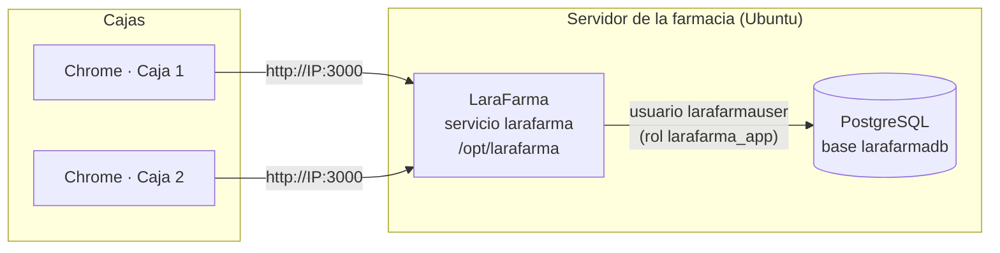
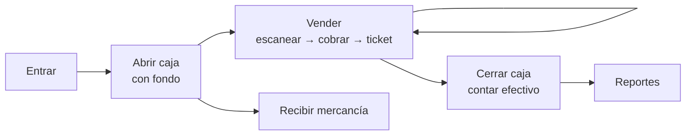

# Guía del sistema LaraFarma

Explicación de punta a punta: qué hace el sistema, cómo está armado, dónde vive cada cosa y qué hacer cuando algo falla. Para el detalle de cada tema, sigue los enlaces a los demás documentos.

---

## 1. Qué es

LaraFarma es el **punto de venta e inventario** de la farmacia. Se usa en el mostrador, desde el navegador:

- **Vender** con lector de código de barras e imprimir el ticket.
- **Exigir receta** en los medicamentos que la piden (antibióticos, controlados y los marcados con la casilla).
- **Controlar la caja:** apertura con fondo, cobro en efectivo, tarjeta o transferencia, y corte.
- **Llevar el inventario** por lote y caducidad. Siempre sale primero lo que caduca antes (FEFO).
- **Recibir mercancía** del proveedor.
- **Ver reportes** de ventas, utilidad, formas de pago, cajeros y productos, con exportación a Excel (CSV).
- **Administrar usuarios y permisos.**

No vende en línea ni emite facturas fiscales (CFDI).

---

## 2. Cómo está armado

| Pieza | Qué es | Dónde está |
|---|---|---|
| **Navegador** | Chrome en cada caja. No guarda datos ni código del servidor | Cada computadora |
| **Aplicación** | Next.js 16 (React 19). Muestra las pantallas y manda las operaciones a la base | `/opt/larafarma`, servicio `larafarma` |
| **Base de datos** | PostgreSQL. Guarda todo y **aplica las reglas** (permisos, receta, precios, caja) | Base `larafarmadb` |

**Idea clave:** las reglas importantes viven en la base, no en la pantalla. Aunque alguien se salte la aplicación, la base no le deja ver costos, cambiar precios, vender sin receta ni inventar totales.

---

## 3. Personas y permisos

Hay dos roles:

| Rol | Qué puede hacer |
|---|---|
| **Administrador** | Todo, siempre |
| **Empleado** | Solo lo que el administrador active en **Permisos** |

Por omisión, el empleado puede **vender, abrir y cerrar su caja, consultar inventario y recibir mercancía**.

Los 22 permisos se agrupan así:

| Módulo | Permisos |
|---|---|
| Ventas | Vender · Aplicar descuentos · Cancelar ventas · Devoluciones · Ver todas las ventas |
| Caja | Abrir su caja · Cerrar su caja · Retiros y entradas · Ver cajas de otros |
| Inventario | Consultar · Recibir mercancía · Ajustar · Merma · Bloquear lotes · Ver costos |
| Productos | Dar de alta · Editar · Cambiar precios |
| Reportes | Ver reportes |
| Usuarios | Gestionar usuarios · Gestionar permisos (**solo administrador**) |
| Configuración | Editar configuración |

Reglas que la base cumple sola:

- Nadie que no sea administrador puede recibir los permisos de usuarios y permisos.
- Siempre queda al menos un administrador activo.
- Cada quien ve solo sus ventas y su caja, salvo que tenga "Ver todas las ventas" o "Ver cajas de otros".

---

## 4. El día en la farmacia

### Entrar
Correo y contraseña. La primera vez el sistema pide cambiar la contraseña temporal. Tras 5 intentos fallidos la cuenta espera 15 minutos.

### Abrir caja
Se captura el **fondo inicial** (el efectivo para dar cambio). Sin caja abierta no se puede vender. Cada persona tiene una caja abierta como máximo.

### Vender
1. **Escanea** el producto. Funciona aunque el cursor esté en otro lado; el pitido agudo confirma que entró al carrito. También se puede buscar por nombre o sustancia (**F2**).
2. Si algún producto **requiere receta**, aparece el recuadro de receta: médico, cédula, fecha y folio (opcional). En **controlados** hay que marcar que se retuvo la receta original. Sin eso, **Cobrar** no se activa.
3. Elige la forma de pago y, en efectivo, lo recibido. El sistema calcula el cambio.
4. **Cobrar (F9).** La base calcula precios, IVA y totales, toma las piezas del lote que caduca antes y guarda todo. El ticket se imprime solo.

Un ticket se reimprime desde el **Panel** (ventas de hoy).

### Recibir mercancía
Proveedor, factura y fecha. Se escanean los productos: el mismo producto seguido suma piezas. Cada renglón lleva **lote, caducidad, piezas y costo**. No se reciben lotes ya caducados ni facturas repetidas.

### Cerrar caja (corte)
Se cuentan billetes y monedas por denominación. La base calcula el **efectivo esperado** (fondo + ventas en efectivo) y la diferencia. Mientras la caja está abierta, el empleado no ve el esperado: es un **corte ciego**.

### Reportes
Día, semana, mes, año o un rango propio. Muestran ventas, utilidad, margen, IVA, formas de pago, cajeros, categorías, productos más vendidos y horas pico, comparados con el periodo anterior. **Exportar ventas (CSV)** abre en Excel.

Más detalle: [Manual de uso](manual-de-uso.md).

---

## 5. Pantallas

| Pantalla | Para qué | Permiso |
|---|---|---|
| Panel | Resumen del día, alertas de inventario y ventas de hoy | Cualquier cuenta |
| Vender | Punto de venta | Vender |
| Caja | Abrir, ver movimientos y cerrar | Abrir / cerrar su caja |
| Inventario | Existencias, lotes, caducidades y kardex | Consultar inventario |
| Recibir mercancía | Entradas del proveedor | Recibir mercancía |
| Nuevo producto / Editar | Alta y cambios del catálogo | Dar de alta / Editar / Cambiar precios |
| Proveedores y categorías | Catálogos de apoyo | Dar de alta productos |
| Reportes | Finanzas | Ver reportes |
| Usuarios | Alta, bloqueo y reactivación de cuentas | Solo administrador |
| Permisos | Qué puede hacer el empleado | Solo administrador |
| Configuración | Datos fiscales y pie del ticket | Editar configuración |

---

## 6. Los datos

Todo está en PostgreSQL. Lo principal:

| Grupo | Tablas | Nota |
|---|---|---|
| Cuentas | `usuarios`, `sesiones`, `roles`, `permisos`, `rol_permisos`, `bitacora` | Las contraseñas solo se guardan como hash |
| Catálogo | `productos`, `categorias`, `proveedores` | Precio con IVA incluido, en centavos |
| Inventario | `lotes`, `movimientos_inventario` (kardex), `recepciones` | Las piezas de un lote solo cambian con un movimiento |
| Caja y ventas | `turnos_caja`, `movimientos_caja`, `ventas`, `venta_partidas`, `venta_pagos`, `recetas` | Nada de esto se edita ni se borra |

Convenciones:

- **Dinero en centavos:** $35.50 se guarda como 3550.
- **"Hoy"** se calcula en la zona horaria de la farmacia (`America/Mexico_City` por omisión), no en la del servidor.
- **Historial inmutable:** ventas, movimientos, recetas y bitácora no se editan ni se borran. Las ventas se cancelan, no se eliminan.
- **Los folios** (V-000001…) son consecutivos, pero un intento rechazado puede saltarse un número: PostgreSQL no reutiliza números de un consecutivo.

Más detalle: [Base de datos](base-de-datos.md).

---

## 7. Seguridad, en corto

- **Sesiones:** al entrar, la base genera un token que el navegador guarda en una cookie que JavaScript no puede leer. La base solo guarda su hash. Dura 12 horas.
- **Cada consulta** lleva ese token y la base revisa quién es y qué puede ver (reglas RLS).
- **Bloquear** una cuenta la saca del sistema al instante.
- **Usuarios de la base:**
  - `postgres` es el dueño: solo para instalar y administrar. **La aplicación nunca lo usa**, porque el dueño se salta las reglas.
  - `larafarmauser` (miembro de `larafarma_app`) es con el que entra la aplicación.
- **El código** instalado en `/opt/larafarma` solo lo leen root y el servicio. La contraseña de la base está en `/etc/larafarma/larafarma.env` (solo root).

Más detalle: [Seguridad](seguridad.md).

---

## 8. Dónde vive cada cosa en el servidor

| Qué | Dónde |
|---|---|
| Aplicación instalada | `/opt/larafarma/app` (versión anterior en `app.anterior`) |
| Conexión a la base | `/etc/larafarma/larafarma.env` |
| Servicio | `/etc/systemd/system/larafarma.service` |
| Abrir el navegador al iniciar sesión | `~/.config/autostart/larafarma.desktop` → `/opt/larafarma/abrir-navegador.sh` |
| Base de datos | PostgreSQL, base `larafarmadb` |

Comandos de todos los días:

| Para | Comando |
|---|---|
| ¿Está corriendo? | `systemctl status larafarma` |
| Ver errores | `sudo journalctl -u larafarma -n 50` |
| Reiniciar | `sudo systemctl restart larafarma` |
| Respaldar la base | `sudo -u postgres pg_dump -Fc larafarmadb > larafarma-$(date +%F).dump` |
| Actualizar el sistema | Clonar la rama `postgres` y correr `bash scripts/servidor/instalar.sh` |

**Respaldos:** guarda el archivo `.dump` fuera del servidor (USB o nube), por lo menos una vez por semana. Para restaurarlo en una base vacía: `sudo -u postgres pg_restore -d larafarmadb archivo.dump`.

Instalación paso a paso: [Instalación](instalacion.md).

---

## 9. Cuando algo falla

| Síntoma | Causa probable | Qué hacer |
|---|---|---|
| El navegador dice que no se puede conectar | El servicio no está corriendo | `systemctl status larafarma`; luego `sudo journalctl -u larafarma -n 50` |
| "Algo salió mal · No se pudo cargar esta pantalla" en todas las pantallas, o "No se pudo completar" al entrar | La aplicación no llega a la base | Revisa que PostgreSQL corra (`systemctl status postgresql`) y la conexión en `/etc/larafarma/larafarma.env` |
| Me saca al acceso a cada rato | La sesión venció (12 h) o la cuenta se bloqueó | Vuelve a entrar; si dice "bloqueada", el administrador la reactiva en **Usuarios** |
| "Demasiados intentos" | 5 contraseñas equivocadas | Espera 15 minutos |
| No deja cobrar | Falta la receta o no hay caja abierta | Llena médico, cédula y fecha; abre la caja |
| "No hay suficientes piezas" | No hay existencia vendible (o los lotes están caducados o bloqueados) | Recibe mercancía o revisa el lote en **Inventario** |
| El ticket abre el cuadro de impresión | Chrome no se abrió con `--kiosk-printing` | Ábrelo desde el inicio automático o revisa que Chrome esté instalado |
| Las cajas no entran con `http://IP:3000` | Firewall o IP equivocada | `hostname -I` en el servidor; si usas `ufw`: `sudo ufw allow 3000/tcp` |

---

## 10. Personalizar sin programar mucho

| Qué | Dónde |
|---|---|
| Nombre y logo | `config/marca.ts` y `public/marca/` |
| Sonido, impresión al cobrar, ancho del ticket (80 o 58 mm), leyenda | `config/punto-de-venta.ts` |
| Textos de cada pantalla | `contenido.ts` dentro de la carpeta de cada pantalla |
| Datos fiscales y pie del ticket | Pantalla **Configuración** |
| Permisos del empleado | Pantalla **Permisos** |

Después de cambiar un archivo, vuelve a correr el instalador para que el cambio llegue al servidor.

---

## 11. Lo que todavía no tiene pantalla

Estas funciones ya tienen permiso definido, pero todavía no tienen pantalla:

- Cancelar ventas y registrar devoluciones.
- Retiros de efectivo, mermas, ajustes de inventario y bloqueo de lotes.

Lo que sigue: [Historial → Lo que sigue](historial.md#lo-que-sigue).

---

## 12. Mapa de la documentación

| Documento | Para quién |
|---|---|
| [Funcionalidades](funcionalidades.md) | Lista completa de lo que hace el sistema |
| [Manual de uso](manual-de-uso.md) | Quien vende y administra la farmacia |
| [Instalación](instalacion.md) | Quien instala o actualiza el servidor |
| [Seguridad](seguridad.md) | Quien quiere saber qué protege el sistema y qué no |
| [Base de datos](base-de-datos.md) | Quien consulta o cambia la base |
| [Arquitectura](arquitectura.md) | Quien programa |
| [Historial](historial.md) | Cómo se construyó y qué sigue |
| [Presentación](presentacion.md) | Resumen comercial: beneficios y cómo funciona |
| [Recorrido para el cliente](recorrido-para-el-cliente.md) | Pantalla por pantalla, para presentar el sistema |
